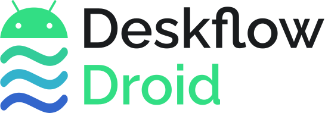

<div align="center">

<picture>
  <source media="(prefers-color-scheme: dark)" srcset="docs/logo-dark.svg">
  
</picture>

Use your desktop's mouse and keyboard on an Android phone or tablet.

**An unofficial third-party client. Not affiliated with, endorsed by, or supported by the Deskflow
project or Symless.**</br>
Any bug belongs to this repository only, so report them here first, not upstream.

</div>

Easily have your Android Phone / Tablet in [Deskflow](https://github.com/deskflow/deskflow) layout. Seamless as its on Desktop application: taps, drags, scrolling, and typing into the focused text field.
Remember It's Client only. It speaks the Synergy 1.6 wire format, so a Deskflow, Barrier, or Synergy 1.8 server should work.

## About this fork

This is a modified fork of ITESaurabh/deskflow-droid, not an official Deskflow release.
The desktop computer is the input server; Android receives its mouse and keyboard.
This app does **not** share an Android-connected mouse back to a desktop.

Local modifications include pointer orientation, Android 13+ accessibility editor input,
best-effort text clipboard sync, a simplified connection screen, and optional wake on mouse entry.
The normal path needs no runtime ADB, Shizuku, root, or replacement input method.
Legacy experimental ADB/UHID helpers are not required for normal operation.

## Requirements

- Android 11 (API 30) or newer
- A Deskflow / Barrier / Synergy server on the same network
- The app's accessibility service enabled; it performs the taps and typing

## Setup

1. On the desktop, add a screen to the server layout and note its name.
2. In the app, enter host, port (default 24800), and that **exact** screen name. A mismatch is rejected by the server.
3. Connect.
4. “鼠标移入时亮屏” controls screen wake on mouse entry. It defaults to on,
   saves immediately, and can be changed while connected. Off disables wake requests only;
   it does not disconnect input sharing. Waking does not unlock the device.

### TLS

The server's certificate is self-signed, so the app pins its SHA-256 fingerprint on first use and
compares against Deskflow's on-screen fingerprint. The desktop asks the same about this device;
the title-bar button shows its fingerprint and randomart. Expect the first connect to bounce twice
while both sides prompt, the client retries itself. "Forget this server" clears the pin.

TLS off in the app means TLS off on the server. There is no negotiation.

## What Works

Move, tap, drag, flick, wheel scroll. Typing in text fields, plus backspace, delete, arrows, Home,
End, Enter. Select all, copy, cut, paste. Escape and right-click go Back, Alt+Tab opens Recents.

## What Doesn't

This is not a general-purpose hardware keyboard driver: games, canvases, some WebViews,
and arbitrary system shortcuts may not work. The enhanced editor path needs Android 13+;
Android 11/12 use the older accessibility path and have not received the same device validation.

Text clipboard sync is best-effort. Android restricts background clipboard reads, so arbitrary
background clipboard monitoring is not guaranteed. Clipboard text is sent to the connected server;
file transfer and drag-and-drop are not implemented.

Screen wake was previously device-tested on a Redmi K40 / Android 13. It requires a live connection:
if Android kills the process or suspends networking during deep sleep, no entry event can arrive.
Other vendors and Android versions need validation; no universal wake guarantee is made.

## 安装与版本 / Install

本仓库是 nmdft 基于 ITESaurabh 原项目维护的修改版，**电脑控制 Android**，
不是把 Android 的鼠标反向共享给电脑。请到本仓库 Releases 下载签名 APK。

- 正式包名：`cn.nmdft.deskflowclient`；初次公开版本 `1.1.0`，versionCode `11`。
- 独立签名，可与上游和旧 `.fix` 测试版共存；不会自动迁移旧版设置、证书或权限。
- 安装后自行启用新应用的无障碍权限，并重新填写服务器和屏幕名。
- “鼠标移入时亮屏”默认开启，开关即时保存；亮屏不解锁。
- 推荐双方启用 TLS 并人工核对证书指纹；只在可信局域网/VPN 使用。
- Android 11+ 可安装；增强文本输入依赖 Android 13+。其他系统/厂商仍需验证。

本版为实验性发布。此前 Redmi K40 / Android 13 验证过亮屏开关，
**新包名的签名发布包尚未重新完成真机交互验收**，不宣称所有设备均可用。
详见 [SECURITY.md](SECURITY.md)、[NOTICE.md](NOTICE.md) 和 [AUDIT.md](AUDIT.md)。

## Build

Requirements: JDK 25 (Gradle daemon toolchain), Android SDK platform 37 and build-tools
37.0.0. Configure `ANDROID_HOME` or an untracked `local.properties`. Dependencies
require internet access. Gradle wrapper and dependency versions are included.

```bash
sh gradlew testDebugUnitTest lintDebug assembleDebug assembleDebugAndroidTest
sh gradlew assembleRelease  # unsigned unless the signing environment is supplied
```

For your own signed build, provide `KEYSTORE_PATH`, `KEYSTORE_PASSWORD`, `KEY_ALIAS`,
and `KEY_PASSWORD` in the process environment. Never commit them. Increase
`versionCode` in `app/build.gradle.kts` for each upgrade; do not derive it from CI
run numbers. Official releases are signed locally; CI has no release key and does
not publish APKs automatically. Keep the same key for future app upgrades.

Device instrumentation tests require an unlocked test device, manual accessibility
setup, and (for LAN tests) the explicitly configured test server. They may change
connection state and are not part of unattended CI. The previous device-test
results are not a claim that this renamed release passed them.

### Legacy helper sources

`keyboard-helper/`, `tools/keyboard.py` and the Start/Stop scripts are retained for
source completeness only. They target the `.debug` build, rely on `run-as` and an
authorized ADB device, and are not supported in the signed release. To experiment,
first build with `sh keyboard-helper/build-helper.sh`; adjust its SDK/JDK environment
for your machine. Do not use these helpers for normal accessibility operation.

## License

Copyright (C) 2026 ITESaurabh

`SPDX-License-Identifier: GPL-2.0-only WITH LicenseRef-OpenSSL-Exception`

Deskflow's `LICENSE` is plain GPL-2.0, but its source files add the OpenSSL linking exception on
top. This client is a fresh Kotlin implementation, not a port, but the message codes, packet
layouts, and KeyID mapping come from Deskflow's sources, so it carries upstream's terms unchanged:
GPL-2.0 **only**, no "or later", exception passed through rather than dropped.

Nothing here links OpenSSL (TLS is Android's JSSE), so the exception is inert. It stays for
whoever forks this into something that does. Texts:
[`LICENSE`](LICENSE), [`LICENSES/LicenseRef-OpenSSL-Exception.txt`](LICENSES/LicenseRef-OpenSSL-Exception.txt).

Upstream also licenses its docs MIT, its artwork GPL-2.0-only, and its bundled KDE Breeze icons
LGPL-2.1-only. None of those files are copied here.

"Deskflow" is the name of the upstream project, used here only to say what this client talks to.
The name and any associated marks belong to their owners, not to this repository.
